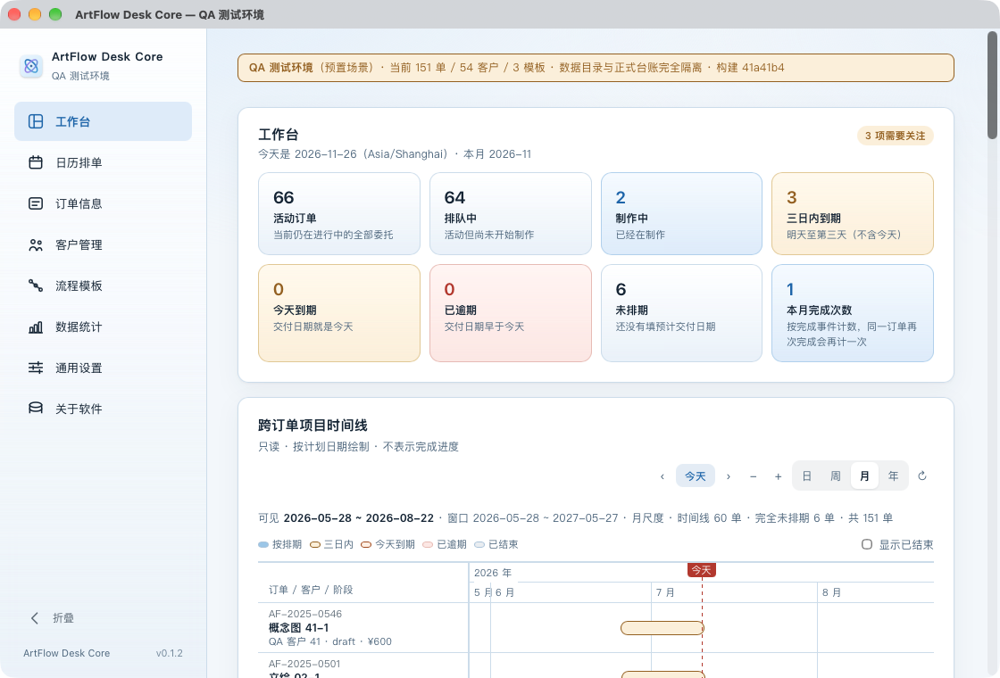
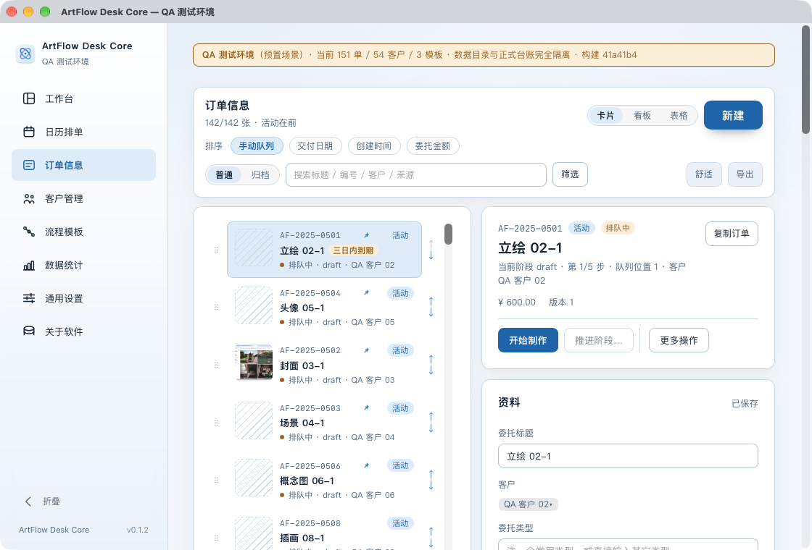
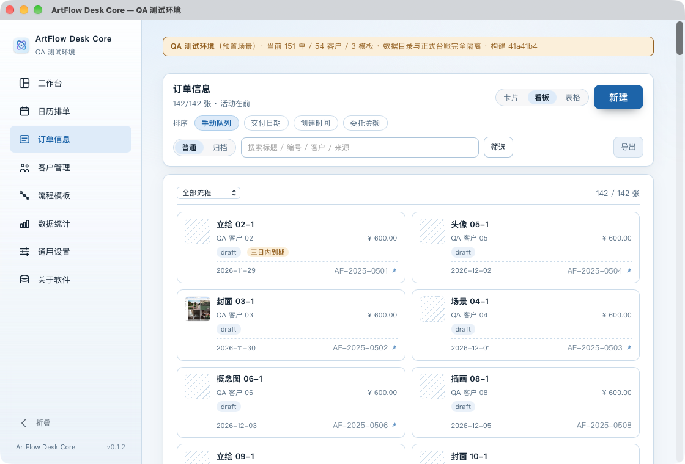
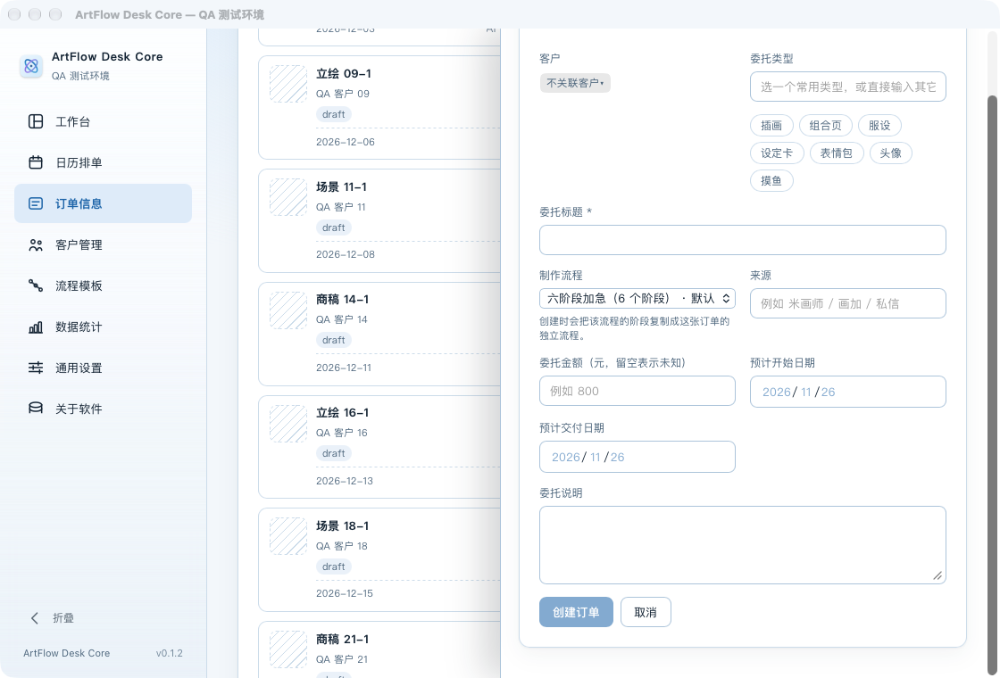
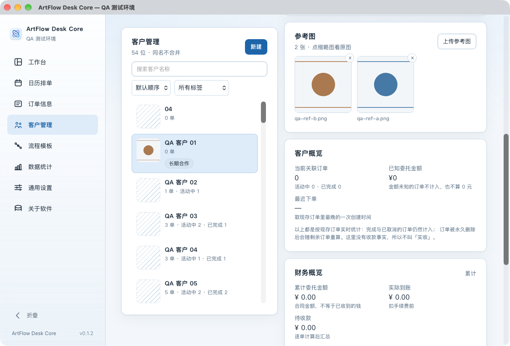
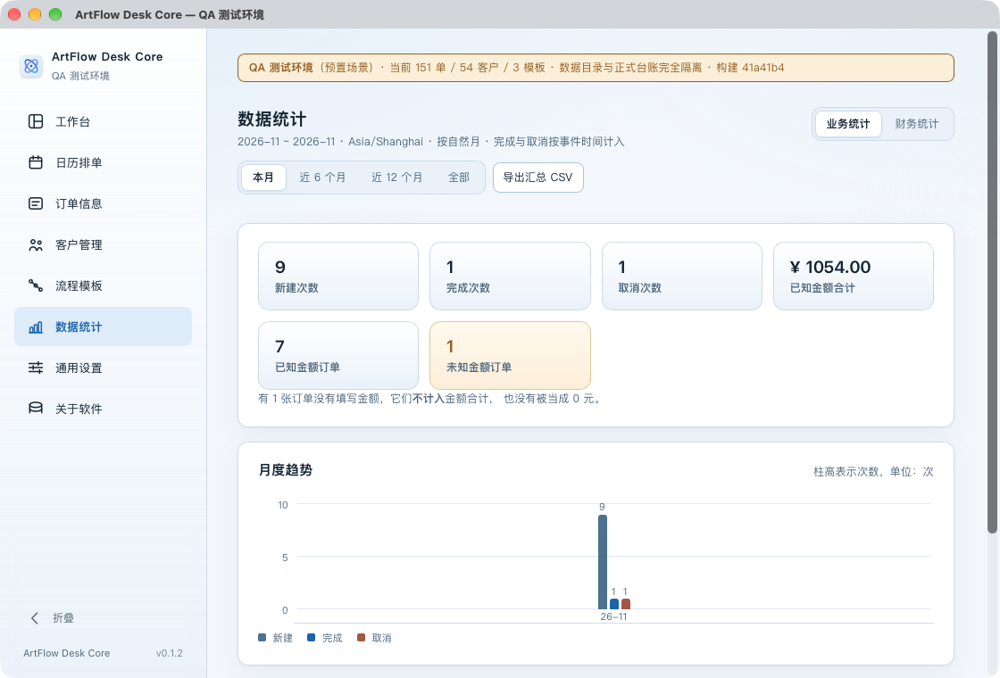
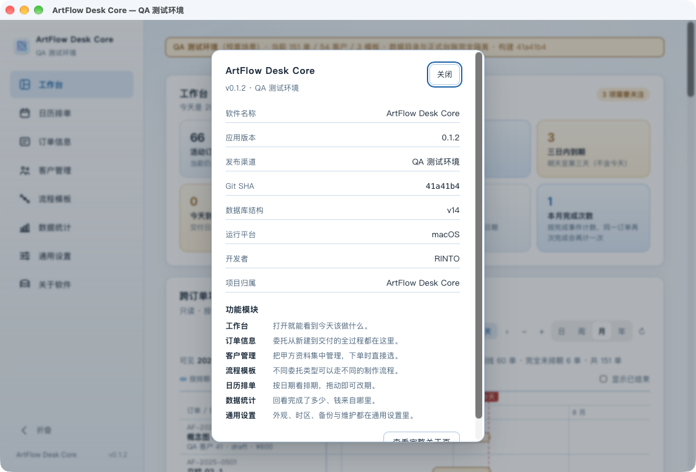
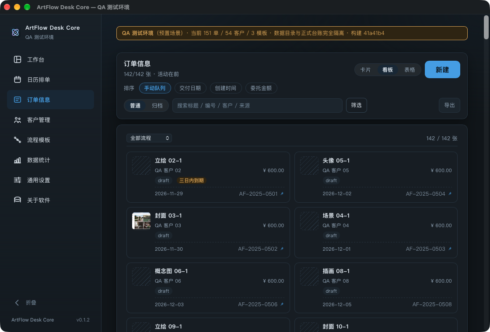

# ArtFlow Desk Core

**v0.1.2**

**A local-first desktop workspace for independent artists to run commissions.**
面向独立画师的本地化委托管理工具：接稿、排单、制作进度、客户资料与财务记录集中在一个工作空间里。

macOS arm64 · Windows x64 · React · Tauri · Rust · SQLite

---

## 它解决什么

独立画师的委托信息通常散在聊天记录、表格和相册里：谁排在第几单、客户上次的参考图在哪、这单做到第几步、什么时候该交、这个月收了多少。ArtFlow Desk Core 把这些收进一个本地应用，一台电脑、一份数据、不需要账号也不需要联网。

- **本地优先**：数据只存在你自己的机器上，不依赖云同步，客户不需要注册。
- **一条线走完**：从接单、排期、制作阶段推进到交付与归档，不必来回切工具。
- **可带走**：整库快照 + 附件 + 校验清单打包成 ZIP，换机器时带走即可。

> 桌面端 ArtFlow Desk Core 与 Web 端 ArtFlow Desk 是同一产品体系下的两个独立产品，工程、数据与发布互不共享。本仓库只包含桌面端。

## 功能

| 模块 | 说明 |
| --- | --- |
| **委托管理** | 卡片 / 看板 / 表格三种视图；卡片与看板带封面缩略图（成品 → 参考图 → 占位）；新建、编辑、复制、取消；委托类型七种高频预设 + 自由输入；标题可按「客户 · 类型」自动生成 |
| **排单与排序** | 手动队列可拖拽、可上下移；另有按交付日期 / 创建时间 / 委托金额的临时排序，只改展示不改真实排单；置顶订单始终在前 |
| **制作流程** | 自定义阶段模板，每张订单持有自己的阶段副本；推进、返工、跳级，改动模板不影响历史订单 |
| **日历排期** | 月 / 周视图，按计划起止日期铺排，拖拽改期并写入排期历史 |
| **客户档案** | 客户资料、标签、关联订单下钻；参考图可上传或拖入，缩略图点开看原图，删除需确认 |
| **数据统计** | 业务统计与财务统计共用页头；三种财务口径互相独立；按当前筛选导出 CSV |
| **数据安全** | SQLite + 代际目录；升级自动迁移并保留旧代际；备份前自动快照，恢复在隔离代际完成 |
| **主题系统** | 浅色 / 深色 / 跟随系统，可调强调色与应用图标（Orbit / Layers / Wave） |

## 界面

| 工作台 | 订单卡片 |
| --- | --- |
|  |  |

| 看板 | 新建订单 |
| --- | --- |
|  |  |

| 客户管理（含参考图） | 数据统计 |
| --- | --- |
|  |  |

| 版本信息 | 深色主题 |
| --- | --- |
|  |  |

截图来自 QA 沙箱，数据为虚构测试数据；拍摄说明见 [SHOTS-0.1.2.md](docs/assets/screenshots/0.1.2/SHOTS-0.1.2.md)。

## 下载

最新版本见 [Releases · v0.1.2](https://github.com/RintoTan/artflow-desk-core/releases/tag/v0.1.2)，每次发布附 `SHA256SUMS.txt`。

| 平台 | 文件 | 说明 |
| --- | --- | --- |
| macOS 13+ (Apple Silicon) | `ArtFlow-Desk-Core-0.1.2-macos-arm64.zip` | adhoc 签名、**未公证** |
| Windows 10 1809+ / 11 (x64) | `…-Production-Setup.exe` / `…-Production-Portable.exe` | CI 构建，**未经实体机器验收** |

### 安装

**macOS**：解压后把 `ArtFlow Desk Core.app` 拖进「应用程序」。首次打开会被 Gatekeeper 拦一次：在 Finder 里**右键 →「打开」**，弹窗再点一次「打开」。不要关闭系统全局 Gatekeeper，也不建议用命令行移除隔离标记——右键「打开」只需一次，之后这台机器就会记住。

**Windows**：运行 `Setup.exe` 安装，或直接用 `Portable.exe`。未做代码签名，首次运行会有 SmartScreen 提示（「更多信息」→「仍要运行」）。

### 校验

```bash
shasum -a 256 -c SHA256SUMS.txt
```

当前版本的三件产物：

| 文件 | SHA-256 |
| --- | --- |
| macOS arm64 zip | `4a9282a1bfc99dcf1ecac348a7376a16d9c71cb3755a4b0248620280b3e128a5` |
| Windows Setup | `be04dd737835a9f981e369b5ad914284e162ea50aa18505733235614bddb39a8` |
| Windows Portable | `8b01f906eb629eeb3401724da8f718ffb0891eb7ad1730f45836cb532b06a01f` |

## 数据与隐私

- 数据位置：macOS `~/Library/Application Support/dev.artflow.minidesk`；Windows `%APPDATA%\dev.artflow.minidesk`。
- 应用以本地存储为核心，不提供账号系统、云同步或遥测功能；客户资料、订单信息和附件保存在你自己的设备上。
- 备份包**未加密**，内含客户与订单信息，请自行妥善保存。

## 技术栈

| 层 | 选型 |
| --- | --- |
| 外壳 | Tauri 2 |
| 前端 | React 19 + TypeScript + Vite，原生 CSS + Arctic Blue 设计令牌 |
| 后端 | Rust + rusqlite（bundled SQLite） |
| 数据 | 单机 SQLite，schema v14，代际目录 + 指针切换 |
| 测试 | Vitest + Testing Library；Rust 集成测试 |
| 发布 | macOS 本机构建；Windows 由 GitHub Actions 原生 Runner 构建 |

## 开发

```bash
npm ci
npm run tauri dev            # 开发模式（正式 identifier，不要拿它试数据）
npm run qa:seeded            # QA 沙箱，独立数据根，日常开发用这个

npx tsc --noEmit
npx vitest run
cargo test --manifest-path src-tauri/Cargo.toml --features devtools --no-fail-fast

npm run tauri build -- --bundles app
```

- 完整 Rust 测试**必须带 `--features devtools`**，否则探针相关的三组用例是被跳过，不是通过。
- 开发 CLI（`minidesk-probe` / `attachments-probe` / `qa_seed`）挂在 `devtools` 特性下，不进正式包。

## 文档

| 入口 | 内容 |
| --- | --- |
| [文档地图](docs/README.md) | 全部文档的分类、阅读路线与冲突时的权威顺序 |
| [产品概览](docs/product/PRODUCT-OVERVIEW.md) | 定位、用户、业务流程、功能体系 |
| [产品决策](docs/product/PRODUCT-DECISIONS.md) | 已确认的取舍与不可擅改的业务规则 |
| [路线图](docs/product/ROADMAP.md) | 已完成 / 当前 / 规划 |
| [技术架构](docs/architecture/ARCHITECTURE.md) | 技术栈、模块边界、数据模型 |
| [数据安全](docs/architecture/DATA-SAFETY.md) | 存储、迁移、备份、恢复、故障处理 |
| [开发与构建](docs/development/DEVELOPMENT.md) | 环境、测试、构建、发布 |
| [开发交接](docs/handoff/DEVELOPMENT-HANDOFF.md) | 接手入口：目录、数据层、硬规则、坑、验收状态 |
| [项目历史](docs/history/PROJECT-HISTORY.md) | 阶段、版本谱系、schema 演进、被否决的方案 |
| [发布指南](docs/releases/RELEASE-GUIDE.md) | 构建命令、产物、签名与公证说明 |
| [项目状态](docs/releases/PROJECT-STATUS.md) | 版本、平台状态、已知问题 |
| [最终审计](docs/releases/FINAL-AUDIT-0.1.2.md) | 0.1.2 的验收证据与未验证项 |
| [文档审计 2026-11-26](docs/AUDIT-2026-11-26.md) | 本轮审计发现与修复 |
| [用户手册](docs/user-guide/USER-MANUAL.md) | 安装、使用、备份、排错 |
| [变更记录](CHANGELOG.md) | 版本变更 |

## 已知限制

- macOS 为 adhoc 签名、未公证；Windows 未做代码签名。
- Windows 产物由 CI 构建并在 Runner 上完成启动/退出冒烟，**尚未在实体 Windows 机器做安装与日常使用验收**。
- 单机单用户，不含多端同步与协作。

## 开发者与版权

| 项 | 信息 |
| --- | --- |
| 开发者 / 维护者 / 版权所有者 | RINTO |
| 所属产品体系 | ArtFlow Desk |

## 许可证

**尚未指定公开许可证。** 仓库不包含 LICENSE 文件，也不代表以任何开源协议授权使用、分发或修改。如需授权，请联系版权所有者 RINTO。
