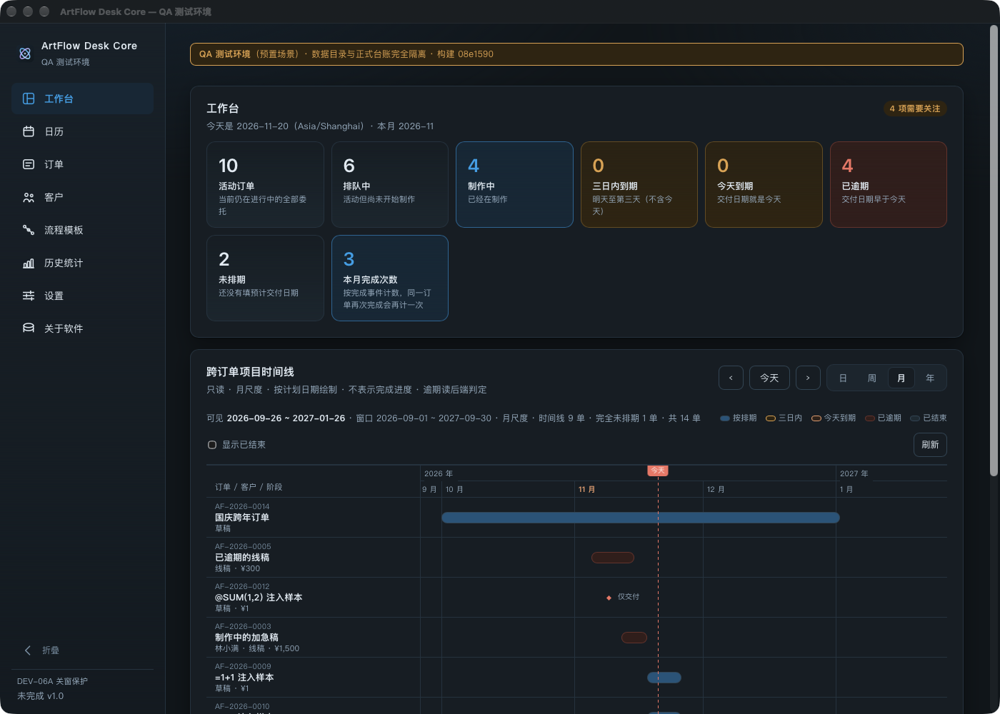
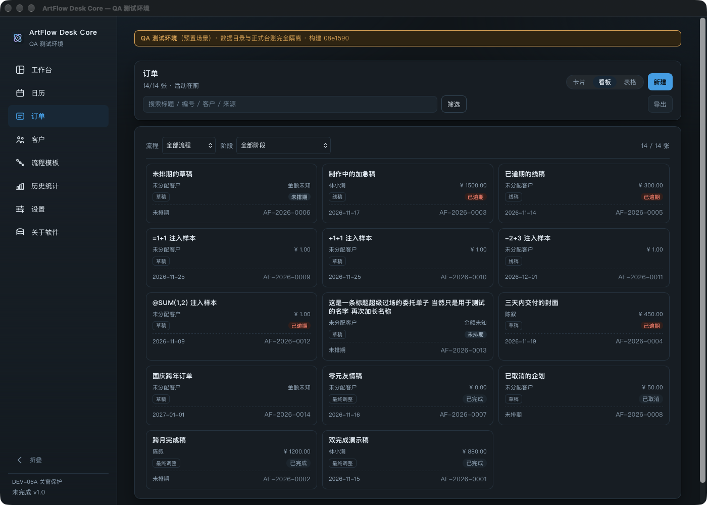
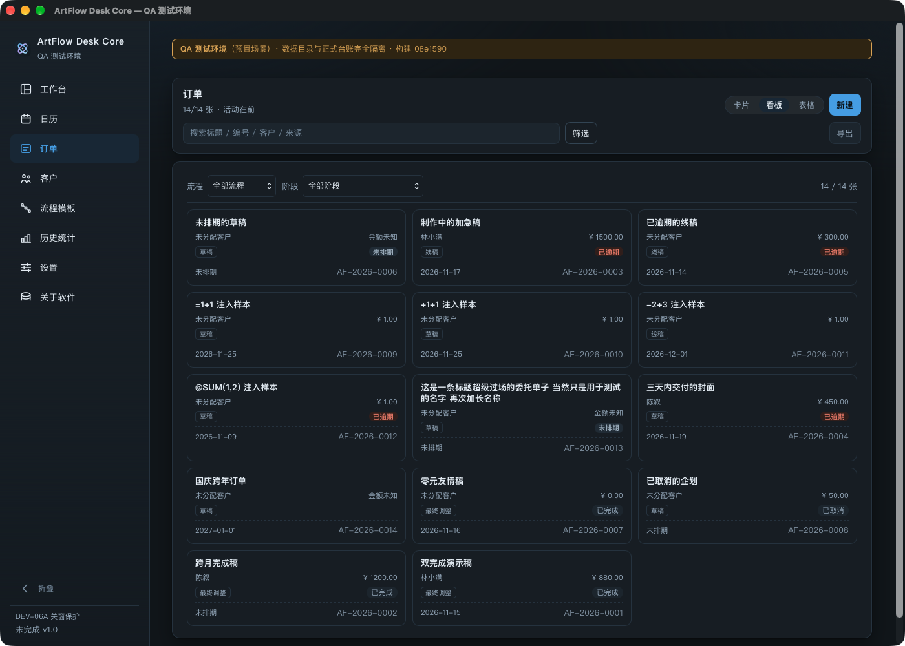
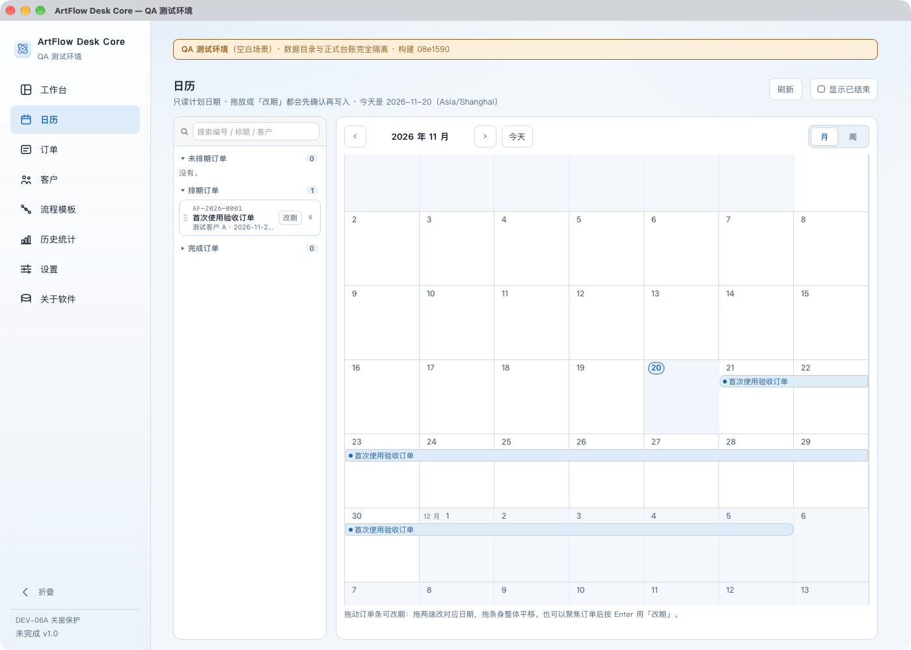
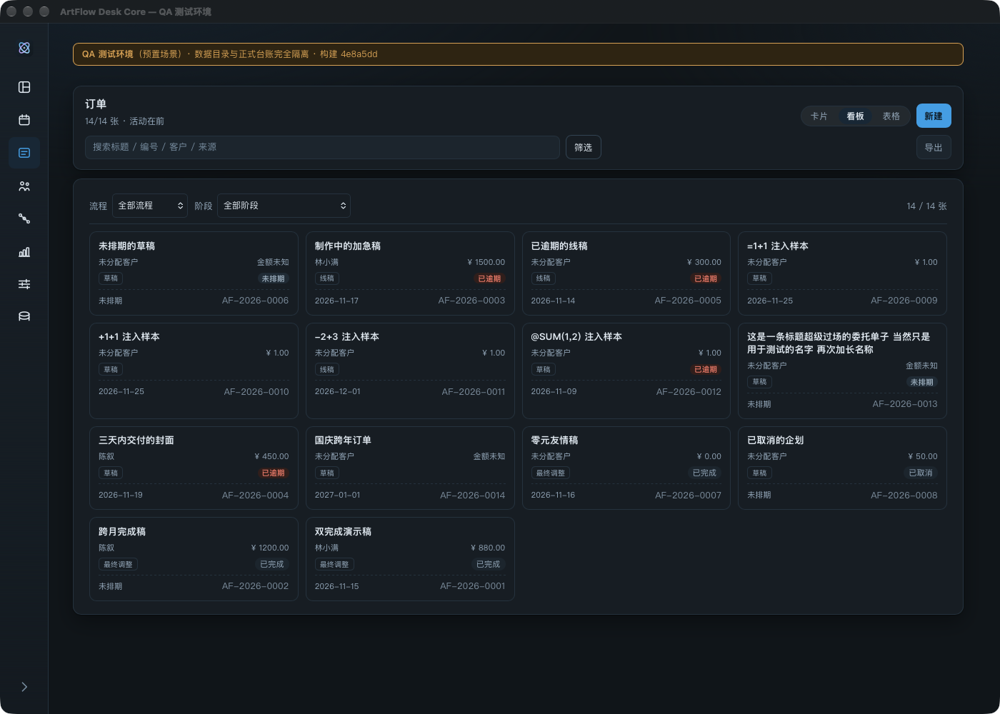
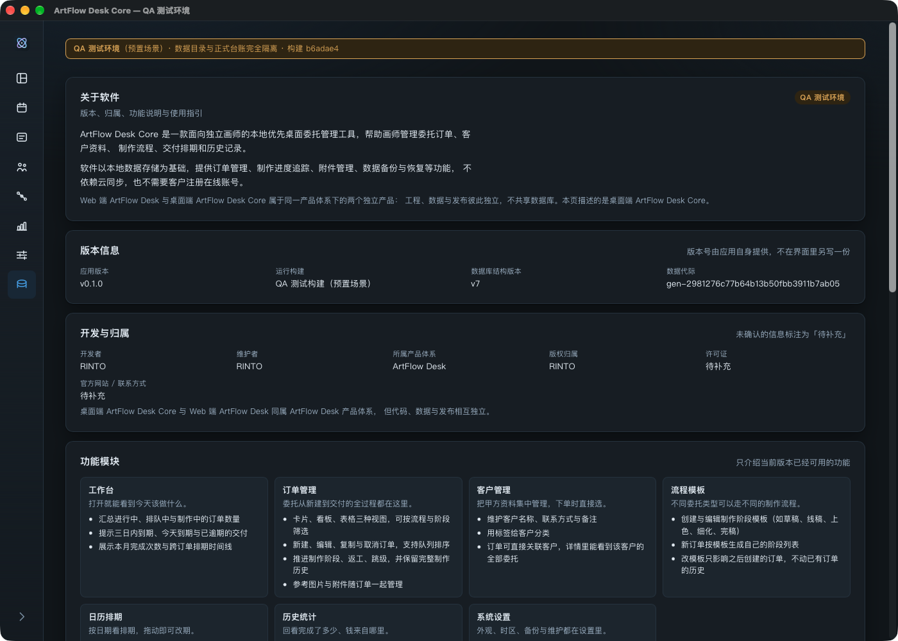
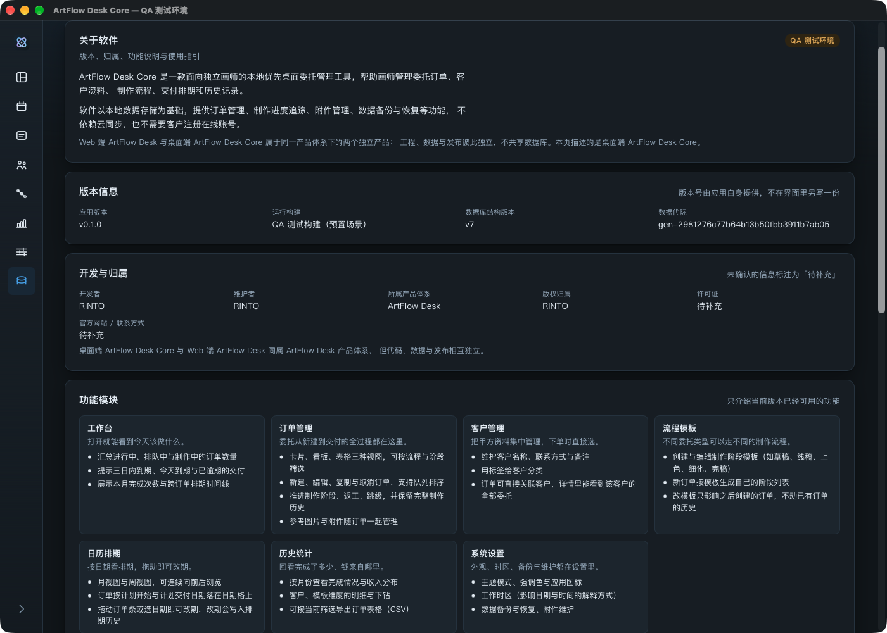

# ArtFlow Desk Core · 画师助手

> 面向独立画师的本地优先桌面委托管理工具。
> A local-first commission management desktop app for independent artists.



## 这是什么

ArtFlow Desk Core 是一款为独立画师设计的桌面委托管理工具，把订单、客户、制作流程、交付排期和数据管理收在一个清晰的工作空间里，减少来回翻聊天记录和表格的时间。

- **本地优先**：所有数据存在你自己的电脑上，不依赖云同步，客户也不需要注册账号。
- **单画师工作流**：从接单、排期、画到第几阶段、什么时候交付，一条线走完。
- **可迁移**：数据可整体导出为备份包，换电脑时带走即可。

> Web 端 ArtFlow Desk 与桌面端 ArtFlow Desk Core 属于同一产品体系下的两个独立产品：工程、数据与发布相互独立，不共享数据库。本仓库只包含桌面端。

## 界面

| 订单列表 | 订单详情与制作阶段 |
| --- | --- |
|  |  |

| 日历排期 | 数据备份与恢复 |
| --- | --- |
|  |  |

| 关于软件 | 使用指引 |
| --- | --- |
|  |  |

截图来自 QA 测试环境（虚构数据），非真实客户信息。
**当前展示图为 0.1.2 之前的界面**：缩略图、四种排序、客户参考图与左下角版本入口尚未出现在这些图里，
0.1.2 正式发布前会统一重拍（见 `docs/releases/DELIVERY-0.1.2.md` 的「待更新」项）。

## 核心功能

- **工作台**：进行中/排队中/制作中订单计数，三日内到期、今天到期、已逾期的交付提醒，本月完成次数，跨订单项目时间线。
- **订单管理**：卡片 / 看板 / 表格三种视图，卡片与看板带封面缩略图（成品优先，其次参考图，缺图给占位块）；新建、编辑、复制、取消；委托类型支持七种高频预设与自由输入，标题可按「客户 · 类型」自动生成；队列排序，另有按交付日期 / 创建时间 / 委托金额的临时排序（只改展示，不改真实排单）；制作阶段推进、返工与跳级；完整制作历史。
- **客户管理**：客户资料与标签；客户可存参考图（选择或拖拽上传、缩略图、点开看原图、删除需确认），参考图随备份包一起迁移；订单可关联客户并下钻查看该客户的全部委托。
- **回收站**：入口在「设置 → 数据维护」。客户组支持整批恢复，独立订单支持单独恢复；也可永久删除或手动清空。永久删除后，关联附件进入延迟清理流程，失败时可重试。
- **流程模板**：自定义制作阶段模板，新订单按模板生成自己的阶段副本，改模板不影响已有订单的历史。
- **日历排期**：月视图 / 周视图，按计划起止日期铺排，拖动或选日期即可改期，改期写入排期历史。
- **历史统计**：按月查看完成情况与收入分布，客户/模板维度下钻，按当前筛选导出 CSV。
- **附件管理**：参考图片多选导入、拖拽导入、缩略图与原图预览；隔离文件与导入记录可手动维护。
- **数据备份与恢复**：整库快照 + 附件 + 校验清单打包成 ZIP；恢复前自动安全快照，全程在隔离代际里完成。
- **系统设置**：主题（浅色 / 深色 / 跟随系统）、强调色、应用图标、工作时区、备份与附件维护、数据维护（回收站）。

## 视觉体系

- **Arctic Blue**：默认浅色主题，冷调、低饱和，长时间看不累。
- **Arctic Line**：图标与应用图标的线条语言。
- **Orbit / Layers / Wave**：三套可切换的应用图标主题。

## 支持平台

| 平台 | 状态 | 说明 |
| --- | --- | --- |
| macOS 13.0+ (Apple Silicon) | Demo 可用 | ad-hoc 签名，未公证 |
| Windows 10 1809+ / 11 (x64) | Demo 可用（实机验收） | 2026-11-20 真机两阶段 56 项：核心功能基本通过；安装/卸载、DPI 125%/200%、中文路径、断网仍未验证 |

## 下载 Demo

见 [Releases](https://github.com/RintoTan/artflow-desk-core/releases) 页（仓库为 Private，需有权限的账号访问）。每次 Demo 附 `SHA256SUMS.txt`。

- **正式版**（`ArtFlow Desk Core`）：用你自己的真实数据，标识 `dev.artflow.minidesk`。
- **QA 版**（`ArtFlow Desk Core QA`）：演示与试玩用，标识 `dev.artflow.minidesk.qa`，数据与正式版完全隔离。

> 当前版本**未做 Apple Developer ID 签名与公证**，macOS 首次打开需「右键 → 打开」；Windows 首次运行会有 SmartScreen 提示。这不是缺陷，是尚未配置签名证书。

## 安装与首次启动

完整手册：[docs/user-guide/USER-MANUAL.md](docs/user-guide/USER-MANUAL.md)
（macOS 首次打开需「右键 → 打开」；Windows 有 SmartScreen 提示，均为未配置签名所致。）

## 数据与隐私

- 数据默认位置：macOS `~/Library/Application Support/dev.artflow.minidesk`；Windows `%APPDATA%\dev.artflow.minidesk`。
- 不联网、不上传、不集成任何第三方分析或云服务。
- 备份包**未加密**，内含客户与订单信息，请妥善保存。

数据存储、代际、备份格式、恢复流程与故障恢复：见 [DATA-SAFETY.md](docs/architecture/DATA-SAFETY.md)。

## 项目文档

| 入口 | 内容 |
| --- | --- |
| [产品概览](docs/product/PRODUCT-OVERVIEW.md) | 定位、用户、业务流程、功能体系、范围 |
| [产品决策](docs/product/PRODUCT-DECISIONS.md) | 已确认的取舍与不可擅自改变的业务规则 |
| [路线图](docs/product/ROADMAP.md) | 已完成 / 当前 / 未来规划与优先级 |
| [技术架构](docs/architecture/ARCHITECTURE.md) | 技术栈、模块边界、数据模型、关键约束 |
| [数据安全](docs/architecture/DATA-SAFETY.md) | 存储、迁移、备份、恢复、故障处理 |
| [开发与构建](docs/development/DEVELOPMENT.md) | 环境、启动、测试、构建、发布 |
| [项目状态](docs/releases/PROJECT-STATUS.md) | 版本、平台状态、已知问题、未关闭事项 |
| [用户手册](docs/user-guide/USER-MANUAL.md) | 安装、使用、备份、排错 |
| [变更记录](CHANGELOG.md) | 正式版本变更 |

## 开发

```bash
npm ci
npm run tauri dev            # 开发模式
npm run tauri build          # 本机构建
npx tauri build --config src-tauri/tauri.qa.conf.json  # QA 版
```

测试：`cargo test --manifest-path src-tauri/Cargo.toml`、`npm test`、`npm run typecheck`。
开发时请用 QA 配置启动（`npm run qa:seeded`），不要用正式 identifier。

完整说明见 [DEVELOPMENT.md](docs/development/DEVELOPMENT.md)；Windows 构建走 [.github/workflows/windows-build.yml](.github/workflows/windows-build.yml)（GitHub Actions 手动触发）。

## 开发者与版权

| 项目 | 信息 |
| --- | --- |
| 开发者 | RINTO |
| 维护者 | RINTO |
| 版权所有者 | RINTO |
| 所属产品体系 | ArtFlow Desk |

## 许可证

**尚未指定公开许可证。** 仓库中不包含 LICENSE 文件，也不代表以任何开源协议授权使用、分发或修改。
如需授权，请联系版权所有者 RINTO。
